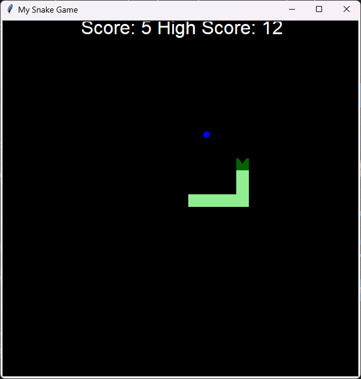

# Snake Game (Day 24)

The classic Snake game, built with Python's `turtle` module. It is the day-24
assignment of Udemy's *100 Days of Code: The Complete Python Pro Bootcamp*. Day 24
teaches the local file system and reading and writing files with `open` and the
`with` keyword, and applies them to the snake game: the scoreboard shows a high
score next to the score, the game goes on after a collision instead of ending, and
the high score is kept in the file `data.txt`, so it is still there the next time
the game is started.

The game has no runtime dependencies. The code keeps the names of the lectures
(`Snake`, `create_snake`, `move`, `reset`, `up`, `down`, `left`, `right`,
`segments`, `head`, `game_is_on`, `Food`, `Scoreboard`, `refresh`, `extend`,
`increase_score`, `update_scoreboard`, `high_score`) so that you can compare it
with your own solution.



*The running game at a score of 5 with a high score of 12: a light green body, a dark
green head with a mouth, the blue food and the white scoreboard.*

This repository continues
[021-snake-game](https://git.tirsystem.com/Tirsvad-Udemy-100-days-of-code/021-snake-game)
and starts from its finished game; `docs/project-plan.md` tells how the work is
split into milestones.

> **Status:** finished. The game of day 21 is adopted and follows the day-24
> lectures: continuous play, a high score next to the score, and the high score
> kept in the file `data.txt`. A short description of the game in English, Danish
> and Bahasa Melayu is on the wiki of the repository (the pages are in `wiki/`).

## Requirements

- Python 3.13 or newer, with `tkinter` (the `turtle` module needs it).
- `git`, to clone the repository.
- Optional: [Doxygen](https://www.doxygen.nl/) to build the source documentation.
- No runtime dependencies. The development tools (`pytest`, `ruff`, `mypy`) are
  installed into the virtual environment by the `dev` extra.

## Set up

Clone the repository, then create a local virtual environment `.venv` in its
root, upgrade `pip` and install the project with its development tools. The
`.venv` folder is ignored by git.

```bash
git clone https://git.tirsystem.com/Tirsvad-Udemy-100-days-of-code/024-snake.git
cd 024-snake
```

### Windows powershell

```powershell
python -m venv .venv
.\.venv\Scripts\Activate.ps1
python -m pip install --upgrade pip
python -m pip install -e ".[dev]"
```

If PowerShell refuses to run the activation script, allow scripts for this
window only with `Set-ExecutionPolicy -Scope Process -ExecutionPolicy RemoteSigned`
and activate again. Python from python.org includes `tkinter`.

### Linux debian

Debian 13 or newer ships Python 3.13. On older releases install Python 3.13
separately.

```bash
sudo apt install python3 python3-venv python3-tk
python3 -m venv .venv
source .venv/bin/activate
python -m pip install --upgrade pip
python -m pip install -e ".[dev]"
```

### MacOS

```bash
brew install python@3.13 python-tk@3.13
python3.13 -m venv .venv
source .venv/bin/activate
python -m pip install --upgrade pip
python -m pip install -e ".[dev]"
```

## Run

With the virtual environment active:

```bash
python -m snake_game
```

It opens a black 600 by 600 window titled "My Snake Game". The snake of three
squares starts in the middle and moves to the right by itself, 20 pixels every
0.1 seconds. Its body is light green and its head is dark green with a mouth.

| Key | Effect |
| --- | --- |
| Up, Down, Left, Right | Turn the snake |

The snake never turns straight back onto itself: the arrow key opposite to the
way it is going is ignored.

A small blue circle, the food, appears at a random place. When the head comes
closer to it than 15 pixels the snake eats it: the food moves to a new random
place, the snake grows by one segment, and the score at the top of the window
goes up by 1.

The scoreboard at the top of the window reads `Score: 0 High Score: 0`. The score
counts the foods eaten since the last reset; the high score is the best score so
far.

The game does not end. When the head passes the wall (more than 280 pixels from
the centre on any side) or touches the tail, the old snake is sent off the
screen, a new snake of three segments appears in the middle, the score goes back
to 0, and the high score is raised if the score was higher. Close the window with
its close button when you have had enough.

### The high score file

The high score is kept as text in the file `data.txt`, in the folder you start
the game from (`python -m snake_game`). The game reads it when it starts and
writes it again each time a new high score is reached, so the high score is
still there the next time you play. The file is created holding `0` the first
time, and a file that is empty or does not hold a whole number is read as `0`.
To start from zero again, close the game and delete `data.txt`. The file is
your own state and is ignored by git. Start the game from another folder and it
uses the `data.txt` of that folder.

## Run the tests

The tests need no display: they use fakes instead of real turtles.

```bash
pytest
```

The same checks that continuous integration runs:

```bash
python -m pytest
python -m ruff check src tests
python -m ruff format --check src tests
python -m mypy
```

## Continuous integration

`.gitea/workflows/ci.yml` runs on Gitea Actions on every push and on every pull
request. It sets up Python 3.13, upgrades `pip`, installs `.[dev]`, then runs
`pytest`, `ruff` (lint and format check) and `mypy`. It does not build the source
documentation: run `doxygen Doxyfile` yourself, as the next section shows. No
step opens a turtle window.

The workflow lives in `.gitea/workflows` and not in `.github/workflows`, so
GitHub does not run it and pushing to a GitHub mirror needs no workflow
permission.

## Build the source documentation

The source is documented with Doxygen comments and the `Doxyfile` in the root.
Install Doxygen (`winget install DimitriVanHeesch.Doxygen` on Windows,
`sudo apt install doxygen` on Debian, `brew install doxygen` on macOS), then:

```bash
doxygen Doxyfile
```

The HTML is written to `build/doxygen/index.html`. A warning fails the build.

## Project layout

```text
.
├── .gitea/workflows/ci.yml    continuous integration (Gitea Actions)
├── docs/                      business case, plan, milestones, reviews
├── src/snake_game/            the game
│   ├── __init__.py
│   ├── __main__.py            starts the game: python -m snake_game
│   ├── constants.py           every constant of the game
│   ├── food.py                the Food class (inherits from Turtle)
│   ├── high_score_file.py     read_high_score and write_high_score (data.txt)
│   ├── main.py                screen set-up and the main flow
│   ├── scoreboard.py          the Scoreboard class (inherits from Turtle)
│   └── snake.py               the Snake class
├── tests/                     pytest tests (fakes.py holds the fake turtle and screen;
│                              conftest.py runs every test in a temporary folder)
├── wiki/                      wiki pages in English, Danish and Bahasa Melayu
├── Doxyfile                   source documentation settings
├── LICENSE
├── pyproject.toml             project configuration
└── README.md
```

## License

GNU Affero General Public License v3.0 only. See [LICENSE](LICENSE).
