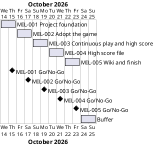

# Project Plan: Snake Game (Day 24)

## Metadata
| Key | Value |
| --- | --- |
| ID | PP-001 |
| CrossReference | [BC-001], [SA-001], [DICT-001], [MIL-001], [MIL-002], [MIL-003], [MIL-004], [MIL-005] |
| Language | en |
| Domain | it |

## Version History
| Date | Status | Author | Reviewer | Change | Commit |
| --- | --- | --- | --- | --- | --- |
| 2026-10-13 | Accepted | Jens Tirsvad Nielsen | S01 | Initial version; accepted by S01 (Product Owner) in chat on 2026-10-13 | [e004c34] |

---

## Purpose

This plan schedules the five milestones that deliver the Snake Game (Day 24) repository of [BC-001]. The repository starts from the finished `main` of [021-snake-game], which holds the snake game of days 20 and 21 with tests and documentation. The milestones therefore set up the repository, adopt that base, add continuous play and the high score of the day-24 lectures, store the high score in `data.txt`, and finish the repository with the README check and a wiki in three languages. Each milestone is one gateway document, one branch and one pull request, so that every step is kept track of and reviewed before the next one starts.

## Planning Assumptions

- The phase starts 2026-10-14 and ends by 2026-10-25, which leaves two days of buffer after [MIL-005]. All dates are proposed and need the Product Owner's confirmation (see Open Issues).
- Phase length: two days per milestone, sized for the spare time of S01, who owns every phase ([SA-001]).
- The starting point is the finished `main` of [021-snake-game], which S01 pointed to in chat on 2026-10-13. The base is copied file by file, so each adopted file is a task, and every difference from the base is listed in the pull request.
- One branch per milestone, named after it (`mil-001-project-foundation` and so on), and one pull request that closes the issues of that milestone with one `Closes #N` line each. The planning documents themselves are delivered on the branch `plan-baseline`.
- S01 switched on autonomous mode in chat on 2026-10-13 (see `AGENTS.md`, Modes): S01's acceptance of this plan is the request, and the commit, the push, the pull request and its merge follow without further asking. The reviews are done by the assistant as stand-in for S01 and are not independent; each record says `Mode: autonomous, not independent`.
- The plan gate is enabled for commits in this clone: a commit that changes `src/` or `tests/` needs a `Task: MIL-NNN#N` trailer for an accepted, reviewed milestone.
- The tokens in `.env` are used only by commands that the assistant runs (repository description and topics, sync of issues); the project never imports, tests or tracks the file.

## Gateway Schedule

| Gateway | Document | Window | Decision date | Owner | Stories | Main deliverable | Milestone |
| --- | --- | --- | --- | --- | --- | --- | --- |
| Project foundation | [MIL-001] | 2026-10-14 to 2026-10-15 | 2026-10-15 | S01 | None (see Open Issues) | `pyproject.toml`, `.gitignore`, `constants.py`, README, `Doxyfile`, CI workflow, repository description and topics | |
| Adopt the game | [MIL-002] | 2026-10-16 to 2026-10-17 | 2026-10-17 | S01 | None (see Open Issues) | `Snake`, `Food`, `Scoreboard`, the main flow and `python -m snake_game`, with their tests | |
| Continuous play and high score | [MIL-003] | 2026-10-18 to 2026-10-19 | 2026-10-19 | S01 | None (see Open Issues) | `Scoreboard.high_score` and `reset`, `Snake.reset`, play without game over, with tests | |
| High score file | [MIL-004] | 2026-10-20 to 2026-10-21 | 2026-10-21 | S01 | None (see Open Issues) | High score read from and written to `data.txt` with `with`, robust against a missing or damaged file, with tests | |
| Wiki and finish | [MIL-005] | 2026-10-22 to 2026-10-23 | 2026-10-23 | S01 | None (see Open Issues) | Wiki in English, Danish and Bahasa Melayu; README checked against the finished game; end-to-end verification | |



## Scope Coverage

| Business Case scope item | Gateway |
| --- | --- |
| Adopting the finished game of the base: configuration, constants, workflow | [MIL-001] |
| Adopting the finished game of the base: `Snake`, `Food`, `Scoreboard`, the main flow and the tests | [MIL-002] |
| Day-24 lecture "High score": `high_score` attribute, `reset` instead of `game_over`, scoreboard text | [MIL-003] |
| Day-24 lecture "Continuous play": no stop on collision; `Snake.reset` moves the old segments off the screen | [MIL-003] |
| Day-24 lectures "Open, read and write files" and "Persist the high score": `data.txt`, `with`, conversion to `int`, write on new high score | [MIL-004] |
| Robust file handling (missing, empty or damaged file) | [MIL-004] |
| Constants in `constants.py`; `src/`, `tests/`, `docs/` layout | [MIL-001], extended in [MIL-003] and [MIL-004] |
| `pyproject.toml`, Python `.gitignore`, `Doxyfile`, README, continuous integration workflow | [MIL-001], README updated in [MIL-002] to [MIL-004] and finished in [MIL-005] |
| Repository description and topics | [MIL-001] (task 7), checked again in [MIL-005] |
| Wiki in English, Danish and Bahasa Melayu | [MIL-005] |

## Dependencies

```
MIL-001 → MIL-002 → MIL-003 → MIL-004 → MIL-005
```

A No-Go on a gateway returns it to S01 for rework and moves every later date by the same number of days; the two buffer days after [MIL-005] absorb a slip before the end date moves.

## Plan Risks

| Risk | Impact | Mitigation |
| --- | --- | --- |
| The planning documents take longer to review than the work left on the game | The first gateway slips | Review [BC-001], [SA-001] and this plan together in one sitting; keep the milestones small |
| Author and reviewer are the same person (S01) | A review can miss a defect | Use the QC checklists and the pull request as the second look; recorded in [BC-001] |
| The git host has no Actions runner | The CI workflow is never executed | Run the same commands locally before each pull request |
| Lecture details are only available as the summaries in the request | The game differs from the video | S01 compares the finished game with the video at the [MIL-003] and [MIL-004] Go/No-Go |
| The sync matches issues by title, so a title used twice overwrites an issue | A task disappears from the board | Every task title is unique across all milestones; check before each `--apply` |
| The base is a copy of another repository | A later fix reaches only one of them | Out of scope by decision (see [BC-001]); each pull request lists the differences from the base |
| The wiki publish workflow needs a secret of the organization | The wiki stays empty | Reported to S01, never worked around; the pages are files in `wiki/` and are not lost |

## Open Issues

- **Dates:** the start date, milestone lengths and the end date 2026-10-25 are proposed and not given by the Product Owner; confirm or replace them.
- **Product Owner (PO) language:** S01 chose English on 2026-10-13; `en` is recorded in `docs/artifact-registry.md`.
- **Stakeholder levels:** the Power and Interest levels of S02 and S03 in [SA-001] are proposals, taken over from [021-snake-game].
- **Starting point:** the finished `main` of [021-snake-game] is the base, as S01 pointed to it in chat on 2026-10-13. Confirm that it is the intended base and not a rebuild from [020-snake-game].
- **Repository address:** the request names `https://git.tirsystem.com/Tirsvad-Udemy-100_days_of_code` (underscores), which is not the repository of `origin` (`Tirsvad-Udemy-100-days-of-code/024-snake`). S01 chose `origin` in chat on 2026-10-13; description and topics are set there.
- **Repository description and topics:** the proposed text is in [MIL-001]; S01 confirms it by accepting this plan.
- **"Python greater than 3.13":** read as Python 3.13 or newer (`requires-python = ">=3.13"`), as in [021-snake-game]. Confirm.
- **README template:** the Product Owner's README template is used. It differs from `framework/templates/README-template.md`, so `framework/scripts/check-readme.sh` stays off.
- **Place of `data.txt`:** the lecture opens the plain name `data.txt`, which is resolved against the current working directory, so the game started from another folder uses another file. [MIL-004] keeps the lecture's name as the default and makes the path a parameter; the alternative is a fixed place per user. Confirm. `data.txt` is listed in `.gitignore`, because it is the player's own state.
- **Robust file handling:** the lecture assumes `data.txt` exists and holds a number. The plan adds a fallback to 0 (objective 6 of [BC-001]) and creates a missing file. Confirm, or ask for the lecture's version without it.
- **Mail merge project:** the request lists the personalised-letters project of day 24. It is a separate program and out of scope here (see [BC-001]); it can get its own repository.
- **Display-free tests:** `Scoreboard` inherits from `Turtle`, so its tests install a fake `turtle` module, as in [021-snake-game].
- **No user story or use case:** the tasks are written as build and check steps, so they are plain technical tasks. If the player's goal should be modelled, add a Use Case Diagram, a user story and a use case and reference them from the task rows.
- **Governance and traceability matrix:** `GOV` and `TM` do not exist yet in this project. Decide whether to create them; the plan proceeds without them and records each review as an `RC-*`. The Domain Dictionary [DICT-001] was added on 2026-10-13 so that criterion 5 of `QC-LANG-001` can be checked.
- **Screenshot:** not part of this plan; a screenshot needs S01's display. It can be added to the README and the wiki later.
- **Diagram check:** the Gantt chart above was not rendered because no PlantUML server is configured (`PLANTUML_URL`); render it before the review.
- **Sync:** `sync-project.sh --apply` is run with `GITEA_TOKEN` from the personal `.env` after the plan is accepted, as in [021-snake-game]; the sync matches issues by title.

---

[BC-001]: ./business-case.md
[SA-001]: ./stakeholder-analysis.md
[DICT-001]: ./dictionary.md
[MIL-001]: ./milestones/mil-001-project-foundation.md
[MIL-002]: ./milestones/mil-002-adopt-the-game.md
[MIL-003]: ./milestones/mil-003-continuous-play-and-high-score.md
[MIL-004]: ./milestones/mil-004-high-score-file.md
[MIL-005]: ./milestones/mil-005-wiki-and-finish.md
[020-snake-game]: https://git.tirsystem.com/Tirsvad-Udemy-100-days-of-code/020-snake-game
[021-snake-game]: https://git.tirsystem.com/Tirsvad-Udemy-100-days-of-code/021-snake-game
[e004c34]: https://git.tirsystem.com/Tirsvad-Udemy-100-days-of-code/024-snake/commit/e004c34565839b38dc1e06c8a05baaa66ce9eb1d
